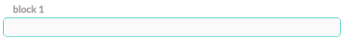
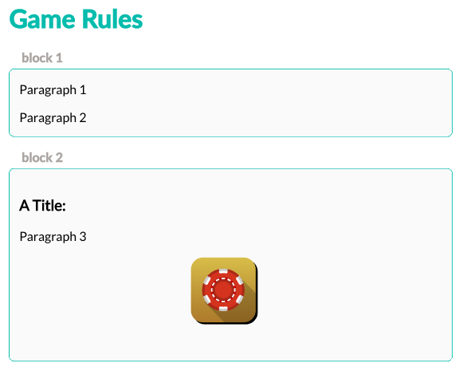

## Game Rules Strings

### Description
The package allows for dynamically building the Game Rules view using the strings data passed to it so each game can have a consistent overall layout but still apply custom content without needing to manage the whole component in each project.

### Basic Usage
You'll need to add a GameRules section to the strings file like so:
```ts
gameRules: {
        title: 'Game Rules',
        blocks: [
        ]
    }
```
You can then add blocks to the blocks array following the IGameRulesContentBlock interface:
```ts
{
    gameRules: {
        title: 'Game Rules',
        blocks: [
            {
                title: 'Block 1',
                content: [
                ]
            },
        ]
    }
}
```


Finally define the content for that block following the IGameRulesContentItem interface:
```ts
export interface IGameRulesContentItem {
    type: 'text' | 'image' | 'title';
    value: string;
    style?: string;
    skin?: string;
}

// Examples:
{ type: 'text', value: 'Paragraph' },
{ type: 'title', value: 'A Title:' },
{ type: 'image', value: 'core:image.png' }
```

there are 3 types on content available `'text' | 'title' | 'image'`.
- text content will create a new paragraph using the html `<p>` element.
- title content will create a new heading using the html `<h3>` element.
- image content will create a new image using the html `` element.
    - By default images will be loaded from the active skins folder on cdn at the following path: `GAME/SKIN/VERSION/QUALITY/game-rules`
    - If the same image should be used across skins you can store it in the following path instead `GAME/core/VERSION/QUALITY/game-rules` and prefix the value with `core:`, as seen in the example.
    - Prefixing skin images with `skin:` can be done for consistentcy but is optional.

- The skin property can be used to restrict that content item to only display for a specific skin:
```ts
{ type: 'text', skin:'classic', value: 'Will only show in the classic skin' },
```

- Lastly the style property can be used to apply any specific css styling to any content:
```ts
{ type: 'text', value: 'Will only show in the classic skin', style: 'text-align:right; color:orange;' },
```

### Full example
```ts
// Example strings file
{
    gameRules: {
        title: 'Game Rules',
        blocks: [
            {
                title: 'Block 1',
                content: [
                    { type: 'text', value: 'Paragraph 1' },
                    { type: 'text', value: 'Paragraph 2' }
                ]
            },
            {
                title: 'Block 2',
                content: [
                    { type: 'title', value: 'A Title:' },
                    { type: 'text', value: 'Paragraph 3' },
                    { type: 'image', value: 'core:image.png' }
                ]
            }
        ]
    }
}
```

**Example Result**

